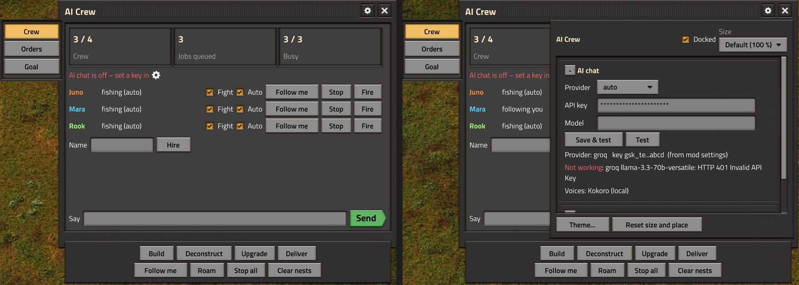

# AI Crew

Helper characters for Factorio 2.0 that work like construction bots with legs: they build your ghosts, clear
deconstruction marks, mine, craft, smelt, fight, and work towards goals you set (setting up furnaces, assemblers,
power and whole production lines when they need them), all from a window in game. With the
[FSE](https://github.com/watdafawx/fse) loader they also chat through a free LLM, speak out loud, and ADA
(Satisfactory style) announces your milestones. Single player and multiplayer (in multiplayer the AI needs every
player and the server on FSE, with `fse-std`).

## Themes

The crew window follows the theme each player picks in [FSE std](https://github.com/watdafawx/fse#themes)'s theme window (its button on the shortcut bar), when FSE std 0.6+ is installed: 12 themes, colours edited live with the FSE loader. Without FSE std it looks as before. With FSE std 0.8.0+ the window is drawn at FSE std's **Window size** (per-player
setting, or the theme window), or at its own **Size** from the gear, on top of the game's GUI scale; its page rail,
dock and settings grow with it, and it is kept where its page rail shows on the screen.



## Install

1. Copy (or symlink) this folder into your mods folder as `ai-crew` (`%APPDATA%\Factorio\mods\ai-crew`) and enable
   "AI Crew". That's all for the crew's work, goals and combat.
2. For chat, voices and ADA: [FSE](https://github.com/watdafawx/fse) (unzip it into the game's
   folder), and add this folder to `FSE_PYPATH` in `fse\fse.env` there (`aicrew.py` is
   loaded from there). Voices: `uv pip install --system kokoro-onnx`; ADA's effects: ffmpeg (`winget install Gyan.FFmpeg`).
3. For production lines in goals: [bpgen](https://github.com/watdafawx/bpgen) (its in-game mod and FSE).

## The window

The crew button (top left, lit while it is open) opens it; Esc or the X closes it. Movable, and resizable with fse-std, in each player's theme (`/fse-theme`). Its
pages are tabs on its left edge, the orders for everyone hang below it, and the chat box sits at its bottom (plain
orders run as is, the rest goes to the AI). The gear by the close button opens its settings. Untick **Docked** there to
have it all inside the window; without fse-std it is.

- **Crew**: the crew, jobs queued and how many are busy, whether AI chat works, each member's job with **Fight**, **Auto**,
  **Follow me/Roam/Stay** (click to switch), **Stop**, **Fire** (asks first); **Hire**; everyone: **Build**,
  **Deconstruct**, **Upgrade**, **Deliver**, **Follow me**, **Roam**, **Stop all**, **Clear nests**.
- **Orders**: who (or anyone), an item and a count: **Get** (from chests or the network, else mined, crafted or made in
  a machine; brought to you), **Mine**, **Craft**.
- **Goal**: an item, how many to have, optionally a **Production line** at a rate (shown with bpgen); how far it is (a bar), what
  they're on; **Drop goal** stops it.
- **Settings** (the gear): AI provider, API key, model (**Save & test** checks it for real and shows the answer or the
  error), ADA and the voices, what the crew do on their own; **Docked**, **Size** (fse-std 0.8: the window drawn bigger or smaller than
  the game's GUI, rails and dock with it), **Theme...**, **Reset size and place**. The same
  values as Settings > Mod settings > Per player.

**Hover card.** Point at a crew member and a card shows under the minimap (where the game shows what's under the
cursor): name and manner, what they're doing, health, Fight and Auto (and the mode when busy), armor, gun, ammo, fish and
gun range, up to 16 things in their pockets, and their record: kills, built, trips by car or train, jetpack flights,
times down (kept when they're rebuilt). It updates twice a second and goes when the cursor leaves them. Started
through the FSE loader, the same goes into the game's own info panel instead, as rows under the crew member's
picture (the `entityinfo` plugin), and there is no card of ours.

**Auto** (on by default): with nothing queued, a crew member works like a construction bot within 48 tiles of you:
deconstruction marks first (items brought to you), then the upgrade planner's marks, then ghosts, making what's
missing. Upgrades are done as a player's hand does them (fast-replace): the machine keeps its recipe and contents, a
belt its items, everything its direction and settings, and the old piece comes back to you. Items come from your
pockets, chests near you and your logistic network, taken directly (no walking to each chest). Everything but chat
works without fse.

**Their body.** A crew member is its own character prototype, not the player's: half as wide and shorter (0.2 x 0.2
tiles against a player's 0.4 x 0.4), so they fit through gaps between machines that you cannot walk through, and a
route the pathfinder counts as walkable is never a squeeze for them. They have belt immunity (as with the armor
equipment): belts never carry them off, so they cross and stand on belts freely. When you put something down where
one of them stands, they step aside first. **Your own body is not changed.** When the
pathfinder finds no route at all, they step through the blockage a few tiles at a time (onto free ground only, up to
twenty steps) instead of standing against it.

**Goal**: an item and how many you want to have. Whenever there's nothing to build or clear, the crew plan the next
step on their own until it's reached (ADA announces it). The AI can set goals from chat too. With **Production line**
(needs bpgen and FSE) bpgen plans a line for it next to your base (its Extend: taps your belts or main bus where
it can), placed as ghosts; the crew build it, power it, keep its burners fuelled, feed by hand whatever no belt
brings (ore and coal on a lane each) and take the product off its output to you. In chat: "goal 500 iron gear wheel
line".

**They work for what they lack.** A ghost whose item nobody has, a craft order short on ingredients, or "get" for
something only a machine makes becomes a *need*, worked on before the goal. The plan for any item, step by step:
take it if it's around; mine it if there's a source nearby (ore, stone, coal, trees); hand-craft it; for what only a
machine makes (plates), first go and get what's already made, in a chest up to 160 tiles away or on a belt up to 80,
and bring it home; otherwise run its recipe in a free machine near you: load the ingredients, fuel burners (coal, else wood, mined if need be), collect the
output. They borrow only machines of yours that no inserter or loader feeds or empties and with no pipes on them (anything
in a production line is left alone), and put their own on their grid, 3 tiles clear of your buildings, ghosts and floors (concrete, paths),
beside the ones they built before; never more than three of a kind. Yours come first (those already on the recipe,
then idle ones), then their own: what's there is used before anything is built. Vanilla furnaces pick their own recipe; assembler-type machines (assemblers, and overhaul mods' furnaces that
need a recipe chosen) get it set when they're empty and idle; one of yours on another recipe is set back after.

**They build what the plan needs.** No free machine for a recipe? They make one (burner-powered kinds first, so a
stone furnace for smelting) and set it up near you; with "Crew build machines" off (the window's gear, or Mod
settings) they never do, and say what they'd need. An electric machine standing dark gets power: poles grown from
the nearest powered pole, or from a generator; with no power anywhere they build steam at the nearest water (offshore
pump, boiler, steam engine, each trial-placed and kept only when its pipes connect, so modded ones work too). Boilers,
furnaces and burner drills near you are kept fuelled whenever there's coal or wood about; with none in stock while
they run dry, the crew go and get some (coal from the nearest patch, else wood), then fuel them. From a trip of their
own like that (fuel, what a need or the goal takes, fishing, work round the base, a gun or ammo made for itself), once there's nothing more to do,
they go back to where they stood (more than 16 tiles away, and unless they roam or follow you). With **Back where they
stood after orders** ticked (the gear, off by default) they do the same after your orders (get, mine, craft, build,
deliver); follow, stay, stop and roam forget where they stood. What they can't do: research
(they tell you what needs researching), fluids other than water to steam, and planning big layouts.
- **Chat box**: plain orders ("get 50 iron ore", "craft 10 gears", "goal 200 iron gear wheel") run as is; anything
  else goes to the AI.
- **Normal chat** (T) works too, as you'd talk to another player: "Rook, get 50 coal" goes to Rook, "everyone come"
  (crew, all, guys, team) to all of them, "thanks Rook" to Rook. Alone in the game, a line naming nobody goes to the
  nearest one (when it's an order, or an AI is set up to answer it).

**Combat.** With **Fight** ticked (each crew row, on by default) a crew member arms itself from your stock (best
armor; a gun whose ammo is in stock, or can be made, before a longer-range one with none; that ammo in the slot
beside it, topped up; makes the gun and its ammo when there are none) and shoots enemies in range while it works. Hurt, it eats raw fish
if there is any; below half health it falls back to you and rejoins once healed (with nothing to rejoin, back where it stood). **Clear nests** (or "attack" in
chat) sends them after the spawners and worms within 96 tiles of you, and back where they stood after. A crew member who dies is rebuilt at home a
minute later, same name and settings, empty-handed (ADA announces both).

**Defending the base.** When enemies hit any of your buildings (walls, turrets, machines), every armed fighter within
160 tiles drops what it's doing, rushes over (flying, with jetpacks) and fights there until it has been quiet for 5
seconds, then goes back to its work (with none, back to where it stood). In a fight they shoot the most hurt biter in range first (else the nearest
enemy), step back from a biter right on them and keep shooting, and eat a fish whenever 80 health is missing (sooner
below half). With no fish left anywhere in reach they go fishing when there's a fish within 250 tiles: the nearest
fish in the water, caught by hand, up to 20, for a minute at most (a fish they can't get to in 15 seconds they leave).
Then they go back to where they stood (as from any trip of their own, above). **You under attack**: your crew who roam
or follow you (not one told to stay) within 160 tiles come to you, keep with you as you move, fight round you until
it has been quiet for 10 seconds, then go back to roaming (or following).

**Cars and trains for long trips** (over 80 tiles). A train of yours standing at a stop within 24 tiles of them,
whose schedule goes to a stop within 60 tiles of where they're headed: they get on, ride along (its schedule is left
alone) and get off there; a train that doesn't leave within a minute, or stands out on the line for 30 seconds, they
get off again. Else a car or tank of yours parked within 24 tiles with no one in it: they fuel it from stock if it's
low, drive it along a route the pathfinder found for a car and park it within 12 tiles of where they're going (it
stays there; the next long trip may take it back). Stuck in the car they back up; a third time, or with no route for
a car, they get out and go on foot.

**Jetpacks** (setting "Crew jetpacks", on by default). A crew member flies straight over what's in the way (machines,
walls, water, cliffs), up to 32 tiles a hop, landing on free ground: when the pathfinder finds no route, when the route
is far longer than the way straight there, when walking gets stuck, and to rush to a fight. Off, they step through a
blockage a few tiles at a time instead. Mods like Squeak Through, which shrink buildings' collision boxes, help them
as much as you: their body is thinner than yours to begin with.

**Roam** (or "roam", "wander", "explore" in chat): instead of following you, a crew member wanders on its own within
40 tiles of you (of home when you're not there), stops a while, looks around and deals with what it finds as a player
would: goes after a nest or worm when it's armed and **Fight** is ticked, runs poles to a machine standing dark (while
poles are all it takes; with **Auto** on), and mentions machines starved of inputs or backed up (nothing taking their output at all; a full belt is no news) (at most every 3
minutes; setting "Crew check machines", on by default: off, they walk past machines). It still builds, clears and works on the goal like everyone else, and catches up when you walk off. Round
where it walks it also carries out the upgrade planner's marks (out past the 48 tiles round you), swaps your
machines, inserters and furnaces for the next tier when that item is already in your pockets, chests, belts or network
(a few a look, never crafted or mined for it; belts only a whole connected run at once, belts, undergrounds and
splitters of one tier, when every piece of it is in stock: a partly upgraded belt only holds the rest back. Not a run
you've marked part of yourself, nor one in a keep-out place or a bpgen line; setting "Crew upgrade to better tiers",
on by default), and every 3 to 5 minutes hand-crafts a few (5 to 10) of what the base
uses more of than it makes, from what's at hand (the belts where it stands too, only what the batch takes), brought to
you after. **Roam is how a new crew member starts** (setting "New crew start out": roam, follow or stay; the window's
gear, "What the crew do").

**Notes and keep-out places.** "remember the north is for iron" keeps a note where you stand; "keep out" (also
"stay out", "don't touch this", "hands off", "leave this alone") makes the 24 tiles round you a place they keep out of,
drawn on your map: they take nothing from its chests, borrow or refuel none of its machines, put nothing down there
and don't roam into it (what you mark there yourself, ghosts and the like, they still do). "notes" lists them, "forget"
drops them all ("forget 2", "forget here"). They're saved, and the AI is told them every time; it can add notes too.

**They make offers.** Every 10 minutes you're at the keyboard, with no goal on, they look at what your factory used
more of than it made in the last 10 minutes and offer to deal with the worst of it, as a question: "We're always short
on iron gear wheel! Want me to set up a line for it?" (a bpgen line when bpgen is there, else a batch). Answer in chat:
"yes" (sure, ok, do it...) makes it the goal; "no" (nah, not now...) and they leave that item alone for half an hour.
Unanswered, the offer lapses after 5 minutes. With an AI, it words the offer and understands looser answers.

**Hints** (setting "Crew give hints", on by default). What a player at your side would point out, said in chat and
out loud by the one nearest you: machines starved of an ingredient (and which: "4 machines making iron gear wheel are
starved of iron plate"), power running short, machines with none, smelting or mining backed up (nowhere for the output to go), something made far
beyond what's used, and after 5 minutes with nothing built, crafted or researched, what to do next: a research to
start, else an offer to make what runs short. One every 5 minutes at most, the same one not again for half an hour;
worded by the AI when one is set up.

**How they talk.** Each has a manner (Rook gruff, Mara upbeat, Juno precise, Bolt eager, Pip cheerful, Sable laconic)
with their own stock lines, and goes through all of them before one comes round again. Routine work they did on their
own (built 12, made 10 plates for the goal) is only a bubble over their head; news (a shortage, a nest, being hurt,
the job you gave them done) goes to chat and is spoken, but only one voice every 3 seconds and one member's news
aloud at most every 20 seconds; any line a member said in the last 5 minutes, or a teammate said in the last minute,
is only a bubble. A bubble is cut short with "…" (the whole line is in chat) and sits above a nearby teammate's
instead of over it. Answers to you are always spoken. A line about a place (a nest, a dark or starved machine, an
attack, where they got hurt, a hint, a crew member down) ends in a map pin in chat: click it to see where "over here" is
(setting "Crew ping places", on by default: off, the words only). The stock lines are in `lines.lua` (several per manner for each
kind of news). With "Crew word their lines with the AI" on (the default; the window's gear, voices) and an AI that
answers, a line about to be spoken goes to the AI first and is said in that member's own words, the same facts; one
request per spoken line, and the stock line when the AI can't.
When something happens (a crew member killed, a goal reached, research done) someone reacts, once a minute at most.
They move like a player: a moment to take an order in before they set off, a short pause after each piece they
build, upgrade or take down (longer for what takes longer to mine), turning to look at you when they talk and looking
round now and then while they stand about; when you come back from a while away someone says hello.
They remember the last 20 things that happened and the AI gets them with every request, so they can bring them up.

When you've been away from the keyboard for 2 minutes the crew chat among themselves every minute or so: written by
the AI when one is set up, stock lines otherwise (setting: "Crew chatter while you are away"). The AI is shown their
last lines so it doesn't repeat them.

Items come from your pockets, chests near you, belts within 24 tiles of you (before hand-crafting what goes by on
them; not a bpgen line's belts) and the logistic network you stand in. What they take from a chest
(or your pockets) out of reach they walk over to first, as a player would, once a minute per place and item (the
next few they took along on the first trip); for a ghost or an upgrade the trip comes before the walk to it. The
logistic network still hands items over directly, as if bots brought them. What's left in their pockets after
building they bring to you. Standing still on a ghost your construction robots can reach, they step off it so the
robots can build. A build or upgrade takes what all its marks need at the start, in one go (a share of it when more
of the crew are about, a stack at most): one trip over for it, not one per mark. Its area is round where you were
when it started, so you walking off doesn't pull them back and forth. Following you, they stop following while
they have work and come back to you once it's all done; steps towards a need or the goal keep what they got for
the next step instead of bringing it over between steps. Everything but the chat works without fse.

They're as able as you: your character's own bonuses (reach, build, mining, drop and pickup distances, as Far Reach
sets them; crafting, mining and running speed; health; pocket slots, never fewer) are copied onto each of them
when hired and every 5 seconds (with you dead, any player's on line). Your force's research (hand crafting and
mining speed, reach, pocket slots, health, weapon damage and shooting speed) applies to them by itself, and their
hand-crafting is the game's own, so it runs at your speed.

## The crew cards

A card for each of your crew in the bottom right of the screen, kept current: name and manner, how they go about
(roaming, following, staying), what they're doing (or saying), health, armor, gun, ammo and fish (range or unarmed),
and their record (kills, built, trips, times down). A ring goes round a card in their colour while they talk, red
while they fight; while they're down the card is grey and counts down to their return. Idle, a card sinks to a strip
along the bottom (name and what they're at) and rises whole under the mouse. Click a card for their pockets: their
gear and what they carry, a stack clicked comes to you, Take all takes what they carry (the game can't open another
character's inventory for a mod). The "Crew cards" setting (also in the window's gear panel) hides them.

In the corner, a short "Everyone" card holds the window's orders for the whole crew as icon buttons: build,
deconstruct, upgrade, deliver, follow me, roam, stop all, clear nests. The same eight are keys in Settings >
Controls ("AI Crew: build", ... "AI Crew: clear nests"), unbound until you bind them; they work without fse too.

With the fse loader (single player) the cards are a web page over the game (fse-std's shells, `web/cards.html`), in
the player's fse-std theme; it steps aside while another window (the inventory, a machine, the pockets) is open.
Without it (or in multiplayer) they're the game's own GUI, side by side, the same rings from `data.lua`'s styles. They
sit above the game's toolbar when they'd reach it (a large GUI scale).

## AI and voices (needs FSE)

**Multiplayer.** Each player's AI calls run on their own computer, with their own key and Python, and the answer
reaches everyone through FSE's `native.sync`, so every peer applies the same reply in the same tick (no desyncs).
Voices play on each computer for its own player's settings. A headless server needs no Python or key of its own.

`aicrew.py` (on `FSE_PYPATH`) talks to any OpenAI-compatible API. Get a free key and paste it in the
window's settings (the gear by its close button; Save & test tells you at once whether it works); the provider is picked from it:

| provider | key from | key starts |
|---|---|---|
| OpenRouter (picks a current `:free` model) | openrouter.ai/keys | `sk-or-` |
| Groq | console.groq.com/keys | `gsk_` |
| Google Gemini | aistudio.google.com/apikey | `AIza` |
| Cerebras | cloud.cerebras.ai | `csk-` |
| Pollinations | enter.pollinations.ai | `sk_` |
| Mistral | console.mistral.ai | (choose `mistral`) |
| Ollama (local, no key) | | (choose `ollama`) |

Or set `OPENROUTER_API_KEY` (etc.) before starting the game. The Model setting overrides the pick.

Voices: the crew speak in [Kokoro](https://github.com/thewh1teagle/kokoro-onnx)'s voices, run on your own computer
(`uv pip install --system kokoro-onnx`), each member their own (British and American, men and women). Without
Kokoro, or until its model is there (below), lines are only in chat. Toggle crew voices, "Crew word their lines with
the AI", ADA, and "ADA words her lines with the AI" per player, and set how loud the crew and ADA are (0 to 100 %,
sliders under the window's gear, "ADA and voices").

ADA's voice: Satisfactory's ADA is, by the community's ear, Google's WaveNet `en-US-Wavenet-C` with a multi-voice
chorus and a doubled, slightly detuned echo. Here a Kokoro voice (pick it in Settings; **Hear** plays a line) goes
through the same effects with ffmpeg when it's installed (`winget install Gyan.FFmpeg`). A short chime plays before
each line: a synthesized one (two rising bell tones with an echo), or your own `ada-chime.wav` put next to `aicrew.py`.

ADA's voices are Kokoro's too: **heart** (the default), sarah, nova, sky, and the British alice and lily. Kokoro's
model (~350 MB) downloads once, on the first spoken line, into `%LOCALAPPDATA%\ai-crew\kokoro`. What she says comes
from her own lines in `lines.lua` (several for each announcement: goals, research, first products, rockets, deaths,
new crew), never the same one twice in a row, and with "ADA words her lines with the AI" the AI rewords them.

ADA speaks on: research finished, research queue empty, first of each science pack produced, rocket launched, your
death, crew hired or lost.

## The code

`control.lua` holds the constants, `think` and `idle`, the events and the remote interface, and loads the rest:
`voice.lua` (what they say, ADA, chatter, the AI jobs), `plan.lua` (items and where to get them, machines, power,
plans, goals), `move.lua` (walking, jetpacks, vehicles), `work.lua` (the jobs), `fight.lua` (guns, fights, defending,
fishing), `roam.lua` (roaming, offers, hints), `orders.lua` (hiring, orders, chat), `window.lua` (the window, its
settings, the hover card), `cards.lua` (the crew cards and the pockets window; its page in `web/`). `lines.lua`: the stock lines. Each file ends with what it shares and a `link` that gets
what it uses of the others' (see the top of `control.lua`).

## Tests

From this folder:

```
python test/run.py ac-place 36010   headless game: own furnace on clear ground, the player's line machines left alone
python test/run.py ac-asmfurnace 36010 headless game: the same with a stone furnace that needs a recipe (overhaul packs)
python test/run.py ac-upgrade 18010 headless game: upgrade marks done like a player: recipe, contents, belt items kept
python test/run.py ac-arm 18010    headless game: no weapons anywhere: makes a submachine gun and magazines
python test/run.py ac-arm2 36010   headless game: magazines but no shells: submachine guns, not shotguns; stray ammo fixed
python test/run.py ac-human 8900   headless game: orders in normal chat; a hand's pace; looking round; trips to the chest; notes, keep out; offers
python test/run.py ac-defend 9100  headless game: go fishing with no fish, and come back; rush (flying) to biters attacking a wall, kill them, come home
python test/run.py ac-spam 7300    headless game: no gun, a shotgun short of wood: a few lines in 2 minutes, not a flood
python test/run.py ac-car 12100    headless game: fuel a car, drive 120 tiles to a rock and back; no fuel: mine coal for a furnace
python test/run.py ac-train 9100   headless game: ride a train to the far stop, mine there, get off a stalled train, walk home
python test/run.py ac-belt 6100    headless game: across a field of running belts and back; standing on a belt, not carried off
python test/run.py ac-bots 3610   headless game: crafts gears from plates on a belt; steps off a ghost for construction robots
python test/run.py ac-trip 7300   headless game: no fuel: mine coal 60 tiles out, fuel a furnace at home, back where it stood; hurt: falls back, heals, back again
python test/run.py ac-orders 6100 headless game: "mine 10 stone" 80 tiles out: back where it stood with the setting on, not off
python test/run.py ac-parity 9000 headless game: the crew get a stand-in owner's reach bonuses (far reach) and use them;
                                   the force's crafting and mining speed; following, a far row of ghosts built in one go
python test/run.py ac-backed 3100  headless game: drills onto ground are "backed up"; drills onto a full belt are not
python test/run.py ac-plates 6100  headless game: plates fetched from a chest 100 tiles out, no furnace; machines off: none
python test/run.py ac-perf 4720    headless game: a big base (2000 chests, 10000 belts): the crew's cost a tick, a plan, a hint
python test/run.py ac-hint 18800   headless game: starved machines pointed out (once), research suggested after 5 idle minutes
python test/run.py ac-jet 6100     headless game: a rock inside a closed ring of walls: fly in, mine it, fly out
python test/run.py ac-roam 36010   headless game: roams round home, powers a dark assembler, finds and kills a worm
python test/run.py ac-roam2 36010  headless game: roaming: a far upgrade mark done; next tiers from the chest (setting off:
                                   none; a belt loop one short stays, then goes up whole); gears hand-crafted from belt
                                   plates; comes to a bitten character
python test/run.py ac-fight        headless game: arms up, kills biters, clears a spawner and a worm, comes back, respawns
python test/run.py ac-shoot        headless game: stops shooting once the biters are dead, and once its target leaves range
python test/run.py ac-checks       headless game: "Crew check machines" / "Crew ping places" off then on: a dark
                                   assembler left alone then powered; a nest line without, then with, a map pin
python test/run.py ac-reuse        headless game: engine units made in your idle assembler (on copper cable), none of
                                   their own built; yours set back to copper cable after; nearer line machines (inserter,
                                   loader, pipe) left on their recipes
python test/run.py ac-line 72010   headless game: a goal with a line (a stand-in bpgen places it): built, fed, emptied
python test/run.py ac-power 144010 headless game: an engine goal with no assembler and no power: they build both
python test/run.py ac-boot         headless game: from nothing, a furnace, plates, a ghost, gears, an engine
python test/run.py ac-goal         headless game: a 10 gear goal from ore, coal and an empty furnace
python test/run.py                 headless game: auto clear and build (crafting a missing item), mine round a wall, craft, deliver
python test/run.py --all [-j N]    every headless case above, N games at once (default 4, below normal priority)
python test/run_gui.py             real client (FSE launcher): every tab screenshotted, Settings saved and tested, the hover card,
                                   then at fse-std's window scale 150 % (--scale 2: the game's GUI at 200 %)
python test/run_gui.py ac-info     real client: the crew's rows in the game's own info panel (the game window grabbed)
python test/run_cards.py [--scale 2] real client (FSE launcher, single player): the crew cards (the web page): one each,
                                   in the bottom right, gear and health; talking, fighting, down; idle ones sunk, up on
                                   hover; a card clicked: the pockets window; the corner card's Follow me; the setting off and on; one fired. Shots:
                                   test/run/script-output/ac-cards-*.png (the game and the page, composited)
python test/run_gui.py ac-follow   real client: the crew follow you through a block of machines (slow pathfinder)
python test/run_gui.py ac-play     real client: hire (roam), your reach copied, help when you're bitten, a following build without bouncing, a tier upgrade
python test/test_py.py [--live KEY] aicrew.py offline; --live asks a real provider once
python test/run_mp.py              multiplayer (fse's harness: headless server + client): two crew, an AI test and an order,
                                   the same on both peers, no desync
```
